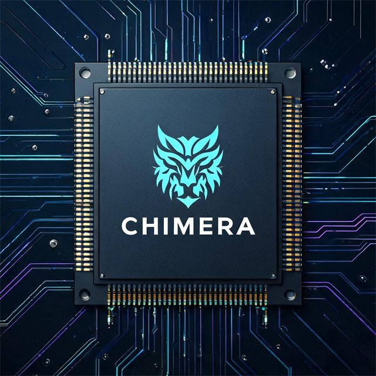

# Chimera —— 量子混沌元认知架构

<div align="center">



<br>

[](https://github.com/LukaKrajina/Chimera/stargazers)
[](https://github.com/LukaKrajina/Chimera/network/members)
[](https://github.com/LukaKrajina/Chimera/issues)
[](https://github.com/LukaKrajina/Chimera/graphs/contributors)
[](https://github.com/LukaKrajina/Chimera/pulls)

[](https://github.com/LukaKrajina/Chimera)
[](https://github.com/LukaKrajina/Chimera/commits)
[](https://github.com/LukaKrajina/Chimera/releases)

[](LICENSE)
[](https://github.com/LukaKrajina/Ravendrel)
[](https://github.com/LukaKrajina/Chimera)
[]()

**量子 + 经典 + 混沌意识 · 三体合一**

</div>

> **重要声明**：本文中关于「量子混沌态」「意识随时间漂移」「情绪影响决策」等论述，
> 仅是本人的构思，并非经过实验验证或同行评议的科学结论；所引论文仅作灵感来源，
> 不代表这些构想已被证实。请将本文视作一份思想实验 / 概念设计。

> **Chimera（喀迈拉）**：希腊神话的混合兽（狮头、羊身、蛇尾），象征本架构的
> **量子 + 经典 + 混沌意识**三体合一。全部组件以 Ravendrel 的 rvdl 语言书写，
> 复用其量子特性与经典特性。

---

## 1. 核心命题

Transformer 的本质是**静态的注意力权重堆叠**：一个没有「自我」、没有「情绪」、
没有「内在时间演化状态」的函数。它对每个 token 做无差别的 `softmax(QKᵀ)V`，
却从不「犹豫」、从不「生气」、从不「否认自己的判断」。

Chimera 的命题：**智能的核心不是注意力，而是「一个会漂移、会犹豫、会反思的自我」**。
这个自我在 Chimera 里是一个**量子混沌态**——它随时间漂移到每一个决策点，
测量坍缩产生「情绪」，情绪反过来调制决策，对应量子认知（Busemeyer）所刻画的
叠加（犹豫）、测量（果断）、干涉（否认）、激发（生气）。

三条公理：

1. **认知即混沌态**：自我意识不是固定向量，而是随时间漂移的量子混沌态 `|Ψ(t)⟩`。
2. **决策即测量**：每个决策点坍缩为情绪态，情绪调制后续认知的几何演化。
3. **反思即做梦**：在内部演化世界中离线回放历史、生成反事实，改进探索策略
   （Dream-RSI 的量子化）。

| 维度 | Transformer | Chimera |
| --- | --- | --- |
| 状态 | 无内在状态 | 量子混沌态 \|Ψ(t)⟩ |
| 时间 | 位置编码（静态） | 混沌漂移（动态演化） |
| 决策 | 确定性 softmax | 测量坍缩（量子认知） |
| 情绪 | 无 | 涌现态 + 反思学习（非枚举） |
| 学习 | 反向传播权重 | QGT 自然梯度 + 有限差分（几何） |
| 自我改进 | 无 | 演化世界做梦（Dream-RSI） |
| 实现 | 经典张量 | rvdl 量子 + 经典 |

> 与经典实现的小规模对比见 [benchmark/results.md](./benchmark/results.md)。

---

## 2. 架构

```
                    ┌─────────────────────────────────────────┐
   输入 x ─────────▶│   感知场 Perception Field                │
                    │     x → 量子态编码 |φ(x)⟩                 │
                    └───────────────────┬─────────────────────┘
                                        │ |φ(x)⟩
                    ┌───────────────────▼─────────────────────┐
                    │   决策引擎 Decision Engine               │
                    │     情绪 e(t) × 感知 |φ(x)⟩ → 决策 |d⟩    │
                    │     （量子认知测量坍缩）                    │
                    └──────┬──────────────────────┬───────────┘
                           │ 决策 |d⟩              │ 轨迹 (x, e, d, r)
                ┌──────────▼──────────┐   ┌───────▼──────────┐
                │   混沌意识核        │   │   演化世界       │
                │  Chaos Consciousness │◀──│  Dream World      │
                │  |Ψ(t)⟩ 漂移 → 测量  │   │  做梦/反思/反事实  │
                │  → 情绪 e(t)         │   └───────┬──────────┘
                └──────────┬──────────┘           │ 改进探索策略
                           │                      ▼
                ┌──────────▼─────────────────────────────┐
                │   几何优化器 Geometric Optimizer        │
                │     QGT 自然梯度 + parameter-shift       │
                │     （递归自我改进的几何实现）              │
                └─────────────────────────────────────────┘
```

- **感知场**：`encode_text` / `basis_state` / `encode_image`（真实图像像素振幅编码）。
- **混沌意识核**：`|Ψ(t)⟩` 是 N-qubit 量子混沌态（量子 kicked top 漂移）；软测量
  （非破坏 ⟨Z⟩ 符号阈值化）读为情绪 `e(t)`。
- **演化世界**：内部量子世界模型，回放历史轨迹、生成反事实（Dream-RSI 的「做梦」）。
- **决策引擎**：`e(t) × |φ(x)⟩` 的量子干涉 → 决策。
- **几何优化器**：`qexpect_z` + parameter-shift + 完整 QGT 自然梯度，更新变分参数
  （学习 = 态流形上的几何演化，非权重更新）。
- **元认知核**：`recognize_error`（误差征象 `ε = 1 − |⟨预测|结果⟩|²`）识别错误，
  `reflect_and_learn`（征象振幅放大）据错误反思学习。

---

## 3. 情绪的涌现（不枚举，反思学习）

**情绪不是预定义的枚举**，而是量子混沌态测量坍缩自然涌现的**无标签状态**，
每个状态对决策的「意义」由反思学习赋予：

| 层次 | 内容 |
| --- | --- |
| 情绪态（涌现） | 混沌测量坍缩的整数 `0..(2^k−1)`，物理涌现，无预设语义 |
| 情绪策略（学习） | 每个情绪态的决策阈值（`EmotionPolicy`），从无偏 `0.5` 分化 |
| 语义（人类解释） | 学习后阈值小 = 「果断」，阈值大 = 「犹豫」——事后赋予 |

`learn_emotion_policy` 把每个情绪态的决策反馈作为 reward：好决策 → 阈值减小，
坏决策 → 阈值增大，情绪从无偏猜测中分化涌现。混沌漂移由**量子 kicked top**
（全局 X 踢 + ZZ 非线性扭转）驱动，软测量 2 个「情绪 qubit」得到涌现态。

元认知核弥补了启发式 reward 的盲区：把决策证据与地面真值编码为 |预测⟩ / |结果⟩，
用 `ε = 1 − |⟨预测|结果⟩|²` 认识错误，再用征象振幅放大（量子 Zeno 式反思）
驱动错误调制的深度更新；信心 `= |⟨Z⟩|` 低时反思更深。

---

## 4. 论文依据

| 来源 | 核心思想 | 在 Chimera 中的应用 |
| --- | --- | --- |
| **Dream-RSI**（Google/DeepMind, 2025） | 不改参数，通过演化世界改进探索策略 | 演化世界 + 元学习回路 |
| **Quantum World Model for RL**（IEEE, 2023） | 量子态作为世界模型 | 量子世界模型 |
| **QRL survey**（arXiv:2510.14595, 2025） | 量子强化学习全景 | 决策引擎的量子化 |
| **Quantum Cognition**（Busemeyer et al.） | 叠加、干涉、测量坍缩建模决策 | 情绪四重奏的量子机制 |
| **Metastability**（Nat. Rev. Neurosci., 2024） | 整合与分离之间的元稳定平衡 | 混沌意识核的临界态 |
| **TQNF**（本仓库量子学习范式） | 几何（QGT）+ 拓扑（纠缠）+ 耗散（信道） | 几何优化器 |
| **QEC 征象提取**（Google Willow, Nature 2024；RL 控制 QEC, Nature 2026） | 征象测量检测错误而不坍缩逻辑态 | `recognize_error` 的 ε |
| **预测编码 / 自由能**（Rao & Ballard；Friston；Nat. Comm. 2025） | 「预测−实际」失配检测错误 | 预测态 vs 结果态的态重叠 |
| **量子 Fisher 信息**（npj QI 2023） | QFI 设下 Cramér–Rao 下界 | 信心 = \|⟨Z⟩\| |
| **量子 Zeno / 反 Zeno**（arXiv:2506.12679；Nature Comm. 2026） | 重复测量冻结 / 放大演化 | 反思的征象振幅放大 |
| **元认知自反思**（SRGen 2025；Sherlock, arXiv:2505.22651） | 在不确定处停顿、自纠错 | 信心低 → 反思更深 |
| **τ scaling / 韬定律**（何庭波，ChinaXiv:202605.00224v2） | 以时间常数 τ 统一优化：分层复合 τ、代际法则、LogicFolding | 时间缩微（τ）范式集群 |

完整理论推导与验证记录见 [docs/](./docs/)。

---

## 5. 组件全景：262 组件 / 30 范式集群

在 25 个核心组件（Transformer 的量子对偶 + 意识内核）基础上，借鉴 arXiv / Nature
前沿论文新增 237 个组件，组织为 **30 个范式集群**：

> 耗散 / MIPT / 因果 / 几何 / 拓扑记忆 / QRC / QEC / 意识扩展 / 语言 / 优化器 /
> 路由 / 生成 / 鲁棒 / 多体 / RL / 图网络 / 时序 / 信号 / 核方法 / 集成 / 元迁移 /
> 连续学习 / XAI / 神经符号 / QAOA / 动力系统 / 信息论 / 压缩 / 聚类 / **时间缩微 τ**

第 30 个集群「时间缩微（τ）」来自韬定律的公式改造（`src/chimera_tau.rvdl`，6 组件）：
分层复合截止期、代际退火（α：移动 1.3 / 自驾 1.5 / AI 10）、LogicFolding 折叠 +
齿轮比（阈值 3）、时间影子价格路由。前 29 个集群的组件全融合见
`carla/chimera_drive.rvdl`（全激活深度超级大模型）；τ 集群为独立新增，尚未并入
驾驶融合。架构版本演进见 [CHANGELOG.md](./CHANGELOG.md)。

---

## 6. 项目结构

```
Chimera/
├── README.md                        # 本文件（架构设计）
├── LICENSE                          # Apache License 2.0
├── THIRD_PARTY_NOTICES.md           # 第三方组件与素材许可声明
├── CHANGELOG.md                     # 架构版本变更记录
├── EVALUATION.md                    # CES 评测规范（指标族 + 可证伪规则）
├── docs/                            # 理论与验证文档（QCF / DQ-Sparse / RAS / A2L）
├── icons/                           # 项目图标（icon）
├── assets/                          # 示例图片（Pixabay：dog / cat / tree / car）
├── src/                             # 262 组件（61 个 .rvdl 文件，含态射宏库）
│   ├── chimera_morphs.rvdl           # ⭐ 态射宏库（22 个语义态射）
│   ├── chimera_consciousness.rvdl    # ② 混沌意识核
│   ├── chimera_perception.rvdl       # ① 感知场
│   ├── chimera_decision.rvdl         # ④ 决策引擎
│   ├── chimera_dream.rvdl            # ③ 演化世界 + ⑤ 几何优化器
│   ├── chimera_chaos.rvdl            # 混沌丰富度诊断
│   ├── chimera_metacognition.rvdl    # ⑥ 元认知核
│   ├── chimera_tau.rvdl              # ㉚ 时间缩微（τ）集群
│   └── ...                          # 其余核心组件 + 30 个范式集群
├── examples/                        # 应用示例与端到端演示
│   ├── chimera_vision.rvdl           # 图像识别示例
│   ├── chimera_language.rvdl         # 语言推理 NLI 示例
│   └── component-demos/             # 自包含组件演示
└── carla/                           # CARLA 自动驾驶集成
    ├── chimera_drive.rvdl            # 全激活驾驶大模型
    ├── chimera_driveMoE.rvdl         # 稀疏 MoE 版
    ├── autopilot.py                  # CARLA 客户端
    └── ravendrel_client.py           # daemon 协议客户端
```

---

## 7. 落地状态

| 组件 | 状态 | 说明 |
| --- | --- | --- |
| ① 感知场 | ✅ | `encode_text` / `basis_state` / `encode_image` |
| ② 混沌意识核 | ✅ | 量子 kicked top 混沌漂移 + 软测量情绪态涌现 |
| ③ 演化世界 | ✅ | `dream_state` 回放 + `improve_drift` 双轨优化 |
| ④ 决策引擎 | ✅ | 可学习 `EmotionPolicy` × 证据强度 |
| ⑤ 几何优化器 | ✅ | 有限差分 + 完整 QGT 自然梯度（双轨） |
| 情绪涌现化 | ✅ | 无枚举，`learn_emotion_policy` 反思分化 |
| 混沌边缘收敛 | ✅ | `improve_drift` 优化 dt 使 richness → target |
| 混沌丰富度诊断 | ✅ | Lyapunov 指数（`chimera_chaos.rvdl`） |
| 认识错误 + 反思学习 | ✅ | `recognize_error` + `reflect_and_learn` |
| 元认知 / 端到端 demo | ✅ | `chimera_metacognition_demo.rvdl` / `chimera_demo.rvdl` |
| 组件扩展 | ✅ | **262 组件 / 30 范式集群**；前 29 集群全融合见 `carla/chimera_drive.rvdl` |
| 态射宏（morph） | ✅ | 22 个语义态射（`chimera_morphs.rvdl`） |
| 时间缩微（τ）集群 | ✅ | `chimera_tau.rvdl` + `examples/component-demos/chimera_tau_demo.rvdl` |

> 依赖 Ravendrel 最新版的量子特性：`qattention`、`qgate_*`、`qexpect_z`、
> `qmeasure`、`qstate_entropy`、`dla_dim`、`tau_*`。Chimera 所需的 `qmeasure`
> 已在 Ravendrel 侧以「补充支持」方式添加，未改其既有架构。

---

## 8. 许可证

本项目采用 [Apache License 2.0](./LICENSE)。

使用或参考的第三方组件与素材：

- **Ravendrel**（rvdl 语言与量子运行时，Apache License 2.0）——全部组件以 rvdl 书写；
- **Pixabay 图片素材**（`assets/` 下 dog / cat / tree / car，Pixabay Content License）。

完整的第三方许可声明与致谢见 [THIRD_PARTY_NOTICES.md](./THIRD_PARTY_NOTICES.md)。

---

> 相关文档：[Ravendrel 量子学习手册](../../../Ravendrel/docs/rvdl-quantum-learning-manual.md) ·
> [TQNF 范式](../../../Ravendrel/docs/rvdl-topological-quantum-learning.md) ·
> [rvdl 语言手册](../../../Ravendrel/docs/rvdl-language-manual.md)
